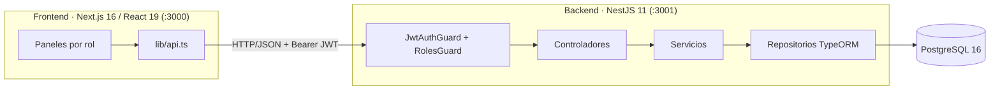
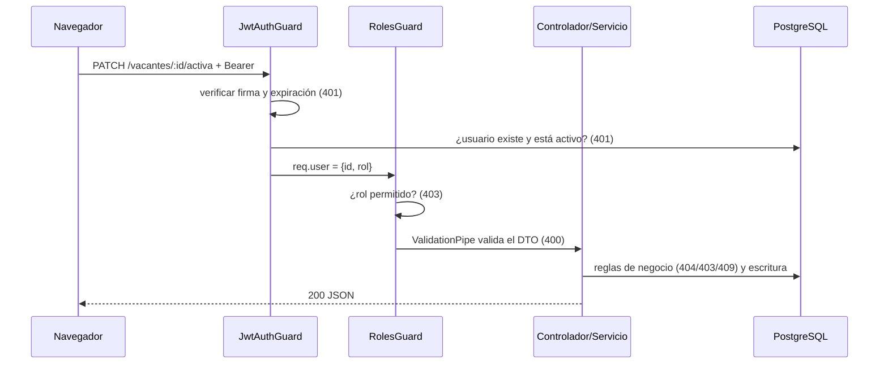

# Arquitectura

Arquitectura cliente-servidor web en tres capas, tal como se definió en el diagrama de paquetes del Taller 2.



## Estructura del repositorio
```
backend/src/
  main.ts                 arranque: CORS, ValidationPipe global, puerto
  app.module.ts           TypeORM (PostgreSQL o sql.js) + módulos
  auth/                   usuarios, perfiles, login/registro, guards
  admin/                  gestión de perfiles por la coordinación
  vacantes/               publicación, auditoría, búsqueda, cierre
  postulaciones/          postulación y seguimiento
frontend/app/             páginas (App Router) · frontend/lib: API y sesión
scripts/seed-demo.mjs     datos de demostración vía API
dev.sh                    levanta PostgreSQL + backend + frontend
docker-compose.yml        PostgreSQL 16
```

## Módulos del backend
| Módulo | Responsabilidad | Depende de |
|---|---|---|
| `AuthModule` (global) | Entidades `Usuario`, `Estudiante`, `Empresa`; registro, login, JWT; exporta `AuthService` y los repositorios | — |
| `AdminModule` | Listar/crear/editar perfiles, activar/desactivar cuentas, restablecer claves | `AuthService`, repos de `AuthModule` |
| `VacantesModule` | Crear, buscar, auditar y cerrar vacantes | repos de `AuthModule` |
| `PostulacionesModule` | Postularse, seguimiento del estudiante, gestión de candidatos | repos de `AuthModule` y `Vacante` |

`AuthModule` es `@Global` porque los guards de todos los módulos necesitan `JwtService` y el repositorio de `Usuario`.

## Flujo de una petición protegida

El `ValidationPipe` global usa `whitelist` y `forbidNonWhitelisted`: cualquier campo no declarado en el DTO se rechaza con 400.

## Reglas de negocio centrales
1. **Auditoría:** toda vacante nace `PENDIENTE`; solo `APROBADA` es visible al estudiante.
2. **Cierre por la empresa:** `activa=false` oculta la vacante y bloquea postulaciones nuevas; las postulaciones existentes y su gestión continúan.
3. **Postulación única** por estudiante y vacante (restricción única en base de datos y verificación en el servicio).
4. **Propiedad:** la empresa solo cierra sus vacantes y solo cambia el estado de candidatos de sus vacantes.
5. **Cuentas desactivadas** no inician sesión ni usan tokens previos; los administradores no se pueden desactivar ni restablecer.

## Bases de datos soportadas
`DB_TYPE=sqljs` usa una base en memoria (pruebas y demo sin Docker); por defecto PostgreSQL. Las columnas de enumeración usan `simple-enum` para que el mismo esquema funcione en ambos motores.
