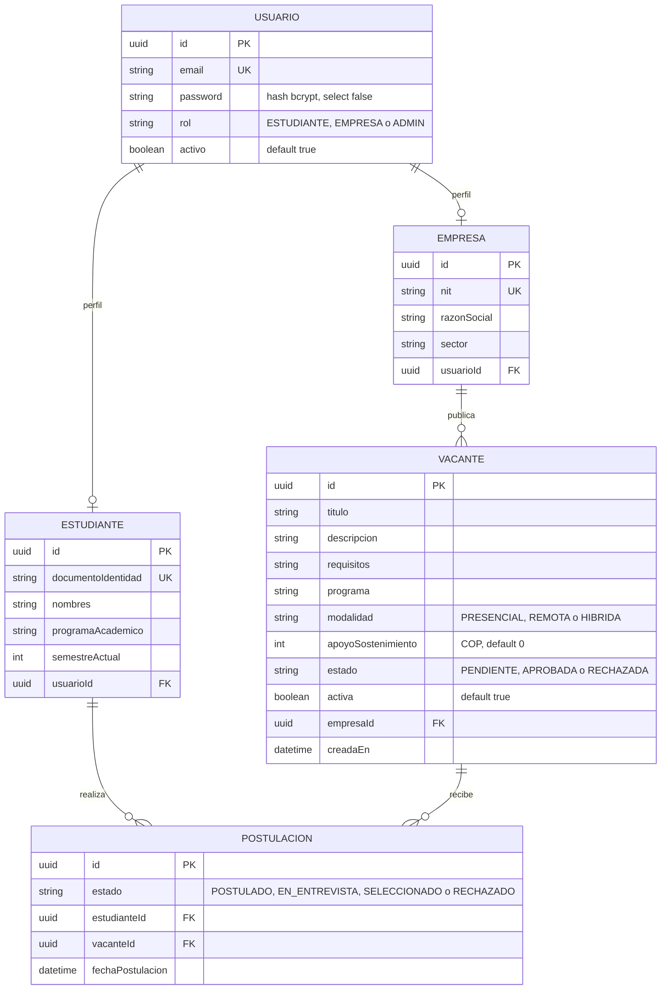

# Modelo de datos

Parte del modelo ER del Taller 2 (se omite `INFORME_SEGUIMIENTO`, fuera de alcance de este prototipo). El esquema lo crea TypeORM con `synchronize`.

## Restricciones
| Tabla | Restricción |
|---|---|
| `usuario` | `email` único. Los administradores no tienen perfil: son filas de `usuario` con `rol=ADMIN`, sembradas al arrancar. |
| `estudiante` | `documentoIdentidad` único; relación 1 a 1 con `usuario`. |
| `empresa` | `nit` único; relación 1 a 1 con `usuario`. |
| `postulacion` | Única por (`estudiante`, `vacante`). |

## Dos estados independientes en la vacante
| Campo | Quién lo cambia | Efecto |
|---|---|---|
| `estado` | Coordinación (solo desde `PENDIENTE` a `APROBADA` o `RECHAZADA`) | Visible al estudiante solo si es `APROBADA` |
| `activa` | Empresa dueña | Si es `false`: no aparece en la búsqueda ni admite postulaciones nuevas |

Una vacante es **postulable** si `estado=APROBADA` **y** `activa=true`.

## Notas de implementación
- `Usuario.password` tiene `select: false`: no se carga en consultas ni en relaciones `eager`. Solo el login la selecciona de forma explícita. Evita filtrar el hash (defecto detectado por la prueba IT-04).
- Las relaciones `Estudiante.usuario`, `Empresa.usuario`, `Vacante.empresa` y `Postulacion.estudiante/vacante` son `eager`.
- Los identificadores son UUID generados por TypeORM.
